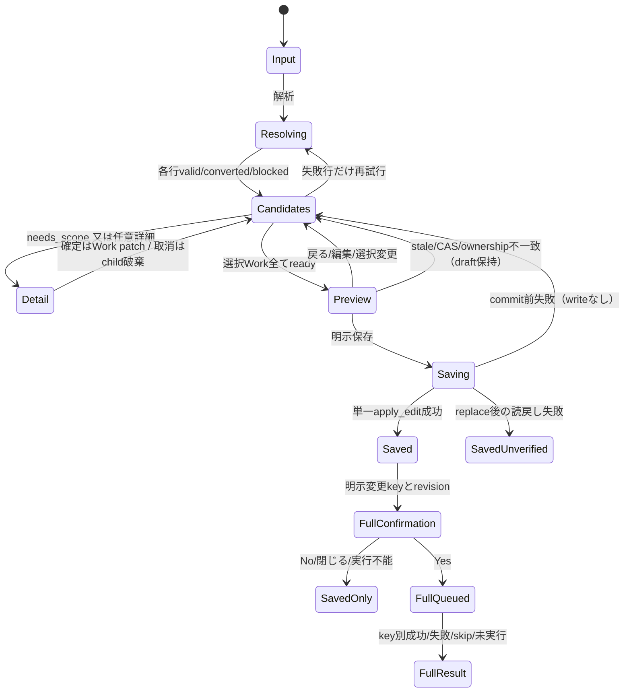

# Stage 00 — 契約監査・採用する実装設計

> 監査日: 2026-11-02 JST。Stage 00 COMPLETE / production implementation NOT STARTED。
> 根拠: ローカルのcode/tests/docsを静的に照合。pytest・アプリ・CDP・実サイトProbeは実行していない。
> この文書は後続Stageの設計契約であり、現在の実装済み機能の説明ではない。

## 1. Checkpointとauthority

- Branch: `main`、HEAD: `faa4677a3f20e0f0b818c81857e33866a5ab1af5`。Stage 00ではbranch切替・commitを行わない。実装Stageはfeature branchで開始する。
- 開始時の既存差分: modified `crawler.yaml`, `watchlist.yaml`; untracked `.None.job.lock`, `.catalog.sqlite.job.lock`, `.watchlist.yaml.job.lock`, `debug.log`。内容を監査材料に使わず、編集・削除・lock取得もしない。
- 書き込み範囲は本Stageの成果物、Stage README、`PROGRESS.md`だけ。運用Catalog、ZIP、Chrome profileは開いていない。
- authorityはAGENTS.md順。Runbook総合READMEの並び（TEST_STRATEGYとDECISIONS等）が異なる部分はauthority変更と解釈しない。
- 照合対象: `docs/SPEC.md`（Browser Session / Work editing / GUI execution）、`docs/ARCHITECTURE.md`（依存方向 / GUI / Browser）、`docs/DISCOVERY_AND_BATCH.md`（Watchlist / Work editing / scope反映）、`docs/BOUNDED_DISCOVERY.md`（境界・complete inventory）、`docs/DECISIONS.md` D-030/D-033/D-037/D-038/D-039、`docs/TEST_STRATEGY.md`、`docs/CODEX_IMPLEMENTATION_GUIDE.md`、`docs/GUI_README.md`。
- 現行ノート: `note/00_core.md`のWork編集・Watchlist・GUI保存/Full節、各site noteのDiscovery契約、`note/07_catalog_position_archive_plan.md`冒頭の現行v7/segments追補、`note/README.md`。古いPhase statusや歴史的schema v3/v6記述を現行契約と混同しない。
- Stage 00は現行仕様・動作・CLIを変更しない監査なのでnoteは変更しない。後続の実装時は`note/00_core.md`と変更site noteを同時更新する。

## 2. 11サイトのURL matrix

### 読み方

以下は**既存コードの受理範囲**であり、新しい登録入口の安全性を保証する表ではない。hostは正確一致（サブドメインのsuffix一致不可）。`www`併記以外の別hostは不可。`n`は既存regexの数値、`h`は13桁の小文字hex。URL identityは整数化せず先頭ゼロを保持する。

共通の新規登録入口はHTTPS、userinfoなし、明示portなし又は443（既存site parserが443不可なら不可）、control文字/backslash/不正port/不正percent escape/曖昧なauthorityなしを先に検証する。未承認query/fragment/paramsは破棄せずblocked。旧parserが余分な部分を無視する場合も、その緩さを引き継がない。

全行のLive欄は「今回未検証」。過去のsite noteにDiscovery実証があっても、今回のResolver・新しい変換・登録時副作用をLive実証済みとは扱わない。

| site / 公式host | 現行Watchlist Discovery起点・parserの実態 | 貼付候補・変換可能性 / 観測 | 作品名の現行根拠・修正案内 |
|---|---|---|---|
| bookwalker / `bookwalker.jp`, `www.bookwalker.jp` | `/series/<n>/list[/]`。`parse_bookwalker_series_url`、pathはcase-insensitive、HTTPS。userinfo/port/query/fragment/paramsを十分検査しない | `/de<uuid>/`は`parse_bookwalker_product_url`で商品IDのみ判明。series IDはURLから導出不可。商品→series/listは同一商品の公式series linkと所属確認、複数候補なら人の選択が必要。reader host/URLは対象外 | `_series_title`が一覧内見出し→可視h1を読む。既存`iter_records`のcanonical titleはlabel優先なので登録前title取得に流用しない。案内「作品の `/series/<id>/list/` を貼り付けてください」 |
| comicdays / `comic-days.com`, `www.comic-days.com` | `/episode/<n>[/]`。`parse_comicdays_episode_url`はquery/fragment拒否、scheme/userinfo/port/paramsは十分検査しない | `/series/...`・Atom URLからseed episodeは決定不可。episodeからもseries IDはURLにない。`_series_id_from_page`の公式feed/data属性を一意検証する観測が必要。登録解析でfull/free Atom全件やreadable-products走査はしない | 完全一覧reader内の `.series-header-title,[class*='series-header-title']`（1件時）、authorは別。labelやAtom entryの話名を作品名にしない。案内「作品の `/episode/<id>` を貼り付けてください」 |
| comicfuz / `comic-fuz.com` | `/manga/<n>`のみ。`parse_comicfuz_work_url`。HTTPS、userinfo/明示port/fragment/params拒否。queryは空又はparse結果が単独`position=thumbnail`のみ。末尾slash不可 | `/manga/viewer/<chapter>`は`parse_comicfuz_episode_url`でchapterのみ判明しwork IDなし。自然な公式work link又はwork-bound metadataの観測が必要。URLだけのepisode→workは未対応 | `_snapshot`がwork route/`#__NEXT_DATA__`/chaptersを照合し`document.title`を使う。titleが非空という現行条件だけでsuffixや読みを推測しない。案内「`/manga/<work id>` を貼り付けてください」 |
| hanayume / `hanayume.com`, `www.hanayume.com` | `/episodes/<h>[/]`。`parse_hanayume_episode_url`。HTTPS、userinfo不可、portなし/443、query/fragment拒否 | `/series/<h>[/]`も`parse_hanayume_work_url`は解析するがDiscovery起点には不可。episode→workは`_read_work_identity`の専用work linkで観測。series→episodeは検証済み同作品linkの選択規則が別途必要。ページ番号付きrangeも起点不可 | `#xHeader a.ep-h-main-h-series`の一意link/textと正確なcanonical series URL。現行Discoveryは認証確認を含む系列往復・range巡回を行うので登録解析には丸ごと使わない。案内「`/episodes/<id>` を貼り付けてください」 |
| jumpplus / `shonenjumpplus.com`, `www.shonenjumpplus.com` | `/episode/<n>[/]`。`parse_jumpplus_episode_url`はhost/pathのみ（scheme等やquery/fragmentを検査しない）。canonical helperはquery/fragmentを落とす | episode IDからseries IDは導出不可。専用series sectionとnative data属性の一意性が必要。series/top/reader/カテゴリから無作為にepisodeを選ばない | snapshotの`section.series-information.type-episode`内title/author、series IDsを`_validate_scope`で検証。話見出しを作品名にしない。案内「`/episode/<id>` を貼り付けてください」 |
| kadocomi / `comic-walker.com`（www不可） | `/detail/KC_<6 digits>_S`。`parse_kadocomi_work_url`。HTTPS、userinfo不可、portなし/443、fragment不可、queryは空又は正確な`episodeType=first`。末尾slash不可 | `/detail/<work>/episodes/KC_<16 digits>_E`は`parse_kadocomi_episode_url`でworkとepisode prefix一致も検査。query許可集合は空、`co=true`、`episodeType=first`、その2つの両順。**episode→workはURLだけで確定変換可能**。pilot採用 | `_canonical_work_title`がwork detailの唯一の`og:title`から既知suffix `｜カドコミ (コミックウォーカー)`を除去。native historyのwork titleと相互検証する既存経路もある。metadata観測はwork detailだけを開きreaderへ行かない。案内「`/detail/KC_<work>_S` 又は対応episode URLを貼り付けてください」 |
| magapoke / `pocket.shonenmagazine.com` | `/title/<n>/episode/<n>[/]`。`parse_magapoke_episode_url`はHTTPS/host/pathを検査するがuserinfo/port/query/fragment/paramsは十分検査しない | title IDはURLにある。`/title/<n>`だけから実在seed episodeを捏造不可。同じtitleの別episodeは同一native work候補、初回入力seedを保持。work→episodeは同titleの公式linkを観測・検証するまで未対応 | `_work_title`、`h1.p-episode__comic-ttl`の可視非空titleが1件。案内「`/title/<id>/episode/<id>` を貼り付けてください」 |
| mangaone / `manga-one.com` | `/manga/<work>/chapter/<chapter>`、末尾slash不可。`parse_mangaone_chapter_url`のwork/chapterは数値限定でない。HTTPS/host検査、userinfo/port/query/fragment/paramsは十分検査しない。malformed URLで例外の可能性 | work IDはURLにある。workだけのURLからchapterを選ぶには同work linkの観測が必要。chapter画像URLは`chapter_id_from_image_url`で一部ID取得できても起点として不可 | `mangaone_title_from_page_title(await page.title())`、サイトsuffix・既知話数見出しを整形。chapter pageを開くとviewer/read-position等が動く可能性があるため登録metadataの非消費経路は未検証。案内「`/manga/<work>/chapter/<chapter>` を貼り付けてください」 |
| piccoma / `piccoma.com`, `www.piccoma.com` | **`/web/viewer/<product>/<episode>[/]`**。`parse_piccoma_viewer_url`。HTTPS、userinfo不可、portなし/443、query/fragment拒否。`urlparse.params`は別途入口で拒否 | `/web/product/<product>/episodes[/]`には`parse_piccoma_listing_url`があるがWatchlist起点には不可。Discovery内部はviewerを開かずproduct一覧へgotoする。product/listing→viewerには同productの実在episode選択が必要。`/web/viewer/s/...`は手動grant用の別契約で登録へ流用しない | 一覧の`#js_contentBody .PCM-headTitle_name`が1件。product IDはviewerから確定可能。案内「`/web/viewer/<product>/<episode>` を貼り付けてください」 |
| younganimal / `younganimal.com`（www不可） | `/series/<h>[/]`。`parse_younganimal_work_url`。HTTPS、userinfo不可、portなし/443、query/fragment拒否 | `/episodes/<h>[/]`は`parse_younganimal_episode_url`でepisodeのみ。work IDなし、episode→workは公式work link等の観測が必要。`/series/<h>/<page>`はrange helper用で起点不可 | `_read_series_title`の非空h1が1件。series IDとrange先titleの変化も現行コードが検査。案内「`/series/<work id>` を貼り付けてください」 |
| zeblack / `zebrack-comic.shueisha.co.jp` | `/title/<decimal>/chapter/list`、末尾slash不可。`parse_zeblack_chapter_list_url`。HTTPS、userinfo/明示port拒否、query/fragmentは無視。`isdecimal()`なのでASCII数字だけの契約ではない | `/title/<id>/chapter/<id>/viewer`はadapter側`parse_zeblack_viewer_url`でtitleを取得できる。viewer→listはURL-only候補として有力（Stage 06）。`?tab=all#top`は既存parser testで受理されるが安全な意味の証拠とはしない | 現Discoveryのcanonical titleは**`target.label`**。protobufの章名やListingPreviewから作品名取得はできない。独立した同title作品名metadataの証拠が必要。案内「`/title/<id>/chapter/list` を貼り付けてください」 |

### matrixの再現可能な根拠

各siteの`src/screenshot_crawler/site_adapters/<site>/discovery.py`と、対応する`tests/unit/test_<site>_discovery.py`を主証拠とした。11サイトの登録元は`cli.py::_discovery_registry()`、viewer registryとは別。

- BookWalker: `parse_bookwalker_series_url`, `parse_bookwalker_product_url`, `_series_title`, `iter_records`。`test_bookwalker_discovery.py`のseries/product/order/title tests、`test_bookwalker_discovery_browser.py`。
- Comic DAYS: `parse_comicdays_episode_url`, `_series_id_from_page`, `_load_complete_records`。`test_comicdays_discovery.py`、`test_comicdays_listing_preview_browser.py`（現行preview/expiry等の回帰を保持）。
- ComicFUZ: `parse_comicfuz_work_url`, `parse_comicfuz_episode_url`, `_validate_page_identity`, `_snapshot`。`test_comicfuz_discovery.py`、`test_comicfuz_discovery_browser.py`。
- Hanayume: `parse_hanayume_episode_url`, `parse_hanayume_work_url`, `_read_work_identity`, `iter_records`。`test_hanayume_discovery.py`, `test_hanayume_discovery_identity.py`, `test_hanayume_discovery_browser.py`。
- Jump+: `parse_jumpplus_episode_url`, `_validate_scope`, `_LISTING_SNAPSHOT_SCRIPT`。`test_jumpplus_discovery.py`、`test_jumpplus_discovery_browser.py`。range番号を話名と対応付けない。
- Kadocomi: `parse_kadocomi_work_url`, `parse_kadocomi_episode_url`, `_canonical_work_title`。`test_kadocomi_work_and_episode_urls_accept_only_observed_shapes`, `test_kadocomi_work_title_comes_from_observed_detail_og_title`、`test_kadocomi_discovery_browser.py`。query両順・wrong work prefixは既存caseがある。
- Magapoke: `parse_magapoke_episode_url`, `canonical_magapoke_episode_url`, `_work_title`。`test_magapoke_discovery.py`、`test_magapoke_discovery_browser.py`。
- MANGA ONE: `parse_mangaone_chapter_url`, `mangaone_title_from_page_title`。`test_mangaone_discovery.py`、`test_mangaone_discovery_browser.py`。
- Piccoma: `parse_piccoma_viewer_url`, `parse_piccoma_listing_url`, `iter_records`。`test_piccoma_discovery.py`のviewer/listing parserとrows title tests、`test_piccoma_discovery_browser.py`。
- Younganimal: `parse_younganimal_work_url`, `parse_younganimal_episode_url`, `_read_series_title`。`test_younganimal_discovery.py`、`test_younganimal_discovery_browser.py`。
- Zeblack: `parse_zeblack_chapter_list_url`, `_build_records`、`adapter.py::parse_zeblack_viewer_url`。`test_zeblack_discovery.py`（query/fragment受理とport拒否も明示）、`test_zeblack_adapter.py`。この名前の独立`test_zeblack_discovery_browser.py`は存在せず、previewのbrowser境界は`test_complete_listing_preview_browser.py`等で扱う。

この監査で実行したparser testsは0。表はソース/既存期待値の照合結果である。

## 3. 重要な非対称性・既存仕様との調整

| 論点 / 根拠 | 採用する解決策・影響 |
|---|---|
| 11サイトともFull complete inventoryを供給し得るが、`preview_complete_listing`をoverrideするのは**magapoke/jumpplus/zeblack/comicdaysの4サイトだけ**（`DiscoveryAdapter` defaultはblocked）。Full proof、bounded対応、GUI previewは別capability | 残り7サイトを含む複数key Workはneeds_scope→理由付きblocked。解析成功を保存readyとしない。未対応previewを通常`discover()`で代用しない。pilot Kadocomiはまず新規単一keyの経路を通す。複数keyの受入は対応4サイト/人工providerで検証し、全11サイト対応と報告しない |
| 既存`WatchlistService._validate_target`はrequired textの非空等のみ。registry/URL安全性・ローマ字形式・既存identity不変までは保証しない | 新規登録serviceで追加検証する。既存YAML/CLIや既存hyphen keyの許容規則を変更しない。既存key/work_key/siteの変更をbulk proposalで拒否 |
| `ListingPreview`に作品title欄はない。`display_title`は話名。Zeblackはlabel由来、BookWalkerもlabel優先 | title用の独立metadata DTOを設ける。ListingPreviewに便宜的作品名を詰めず、placeholder labelからtitleを逆算しない。Discoveryが既存Work.titleを自動修正することにも期待しない（新規WorkはWatchlist labelで初期化） |
| Runbook「単一取得元ready」はURLが読めるだけでreadyという意味ではない | native work identity、titleと命名の確定、既存identity照合、安全な入力を前提とする。新規単一keyならscope未設定を許す。既存Work（CatalogだけのWorkを含む）への追加は現所有関係が不明ならblock。孤立Sourceを新keyへ移さない |
| Stage 04の「既存ターゲットは一切変更しない」は同Stageの明示範囲編集や上位D-039と字義上衝突 | 安定identity・履歴を保持し、既存scope/order/segmentsは初期値としてそのまま載せる。人が明示確認した範囲/配置差分だけ保存する。全key segments必須等で変更が必要なら差分を提示し未承認ではblock。既存ZIP・Source ownerは常に不変 |
| `WorkDraft.add`はarchive_order付きWorkに末尾orderを付与するがsegment Workには自動補完しない。`preview_edit`はsegmentsを再構成し、未採番の複数keyへ順序を付ける | 新key追加直後の混在状態を保存不可のdraftとして許し、Work単位の詳細確定で全keyの整合性を回復。既存segmentをarchive_orderへ縮退させない。未操作previewでの再構成・順序変化も差分表示し、単なるpreviewを人の範囲確認としない |
| `WorkDraft.validate`は新keyの設定操作完了自体を検査せず、異site全話の重複は判別できない。`configured_keys`は置換処理用で確認証拠ではない | 登録側が全関係keyの範囲/担当/完成順を明示確認したWork版とlisting digestに結び付ける。ボタン押下だけでなく実選択・配置の検証に成功した証拠を保存。異siteの内容一致を機械判定しない |
| `validate_work`はQtをimportするGUI moduleにあり、呼ぶ度にCatalogを読む。複数Workは全targetsを保持するため別Workの古いtupleを上書きし得る | Stage 04で小さいQt-free snapshot validatorだけを`watchlist/work_edit.py`へ切り出し、既存GUI wrapper/挙動は維持。bulk serviceは1つのsnapshotと1つの合成proposalで各Workを検証し、Workごとのmember差分だけを統合する。全GUI再設計やCatalog schema変更は不要 |
| CatalogInventoryReaderは既存v7ファイルのみ、WALを拒否し、mode=ro/query_only/1 read transaction。新Work不在は可だがCatalogファイル不在は別 | 「新規Workは保存可能」と「Catalog不要」を混同しない。Stage 01はCatalog不要。Stage 05では指定Catalog読取不能/不在/WALはblockし自動作成・通常Catalogへのfallbackなし |
| Stage 01の純URL解析だけではComic DAYS/Jump+/Hanayumeのwork identityを確定できず、ほかのsiteもtitleがない | URL statusとregistration readinessを分離する。Stage 01で11サイトの起点構文を受理できても全11サイトの即保存は約束しない。site metadata未対応は理由付き保留。観測を増やすのは後続のsite単位Stageのみ |

## 4. ResolverとSite Adapterの最小連携

採用案は既存`DiscoveryAdapterRegistry`を注入し、`DiscoveryAdapter`にデフォルト未対応の小さい任意hookを追加する方式。新しいviewer frameworkや第3の巨大site registryを作らない。

- `registration_hosts`（site-ownedな正確host集合）、`resolve_registration_url(url)`（pure）、`observe_registration_metadata(page, resolution)`（optional async）。名前はStage 01でこの責務のまま確定する。旧adapterはdefault未対応で後方互換。
- 共通`registration/resolver.py`は文字列安全検査、登録adapter選択、status集約だけ。site名if、URL regex、selector、Chrome接続、Catalog/Watchlist writeを持たない。site側hookは既存parse/canonical helpersを呼び、既存parser/Discovery入力契約を緩めない。
- 11サイトのpure hookは既存`discovery.py`内へ短く置く。再利用するsite処理が大きくなるまで別の全site wrapper階層を作らない。registry site集合とhook coverageの一致をtestする。
- title/identity観測もDiscovery Adapter側のsite-owned hookに置くが、`iter_records()`/`DiscoveryService.discover()`を呼ばない。`ListingPreviewService`は詳細設定専用でURL解析とは分離する。
- CDP/endpoint/profile/new Page/closeは外側workerの責務。既存`_ListingWorker`のBrowserSession lifecycleを参照し、Pageだけsite hookへ渡す。GUI threadでアクセスしない。既存タブを再利用しない。
- 新しい任意HTTP clientによるURL解決は採用しない。pilotは公式work-detail PageのDOM metadataだけ。現DiscoveryのAtom/API/pagination観測を登録時に丸ごと再実行しない。

### 共通DTO（提案名。schemaへ追加しない）

| DTO | 必要なデータ / 不変条件 |
|---|---|
| `UrlResolution` | `input_url`, `site`, `discovery_url`, `site_work_identity: str|None`, `status: valid/converted/blocked`, warnings/blockers, evidence（method・rule名・観測URL・時刻）。statusはURLの判定であり保存許可ではない |
| `RegistrationMetadata` | native work identity、title、optional reading、各fieldのprovenance、observed_at、blockers。URL-only根拠とpage観測根拠を区別。titleのみではidentity証拠にならない |
| `RegistrationCandidate` | 行ID（内部だけ）、全元入力、resolution、手編集label/reading/key、手編集フラグ、選択/保留。再試行で他行や手編集を消さない |
| `RegistrationWorkDraft` | 新規/既存の明示選択、work_key、対象member patch、WorkDraftのscope/order/segments/listings、基準revision、Work版、詳細確認proof |
| `RegistrationPreview` | 選択Work版、単一の全target proposal、Watchlist revision、Catalog snapshot identity、詳細proof群、予測影響/UNKNOWN、Full key集合。preview後の編集で無効化 |

native identityは`site + site-native work ID`（例`kadocomi-work:KC_004915_S`、`magapoke-title:01539`）で照合する。series、product、work等はサイト自身の管理単位を尊重する。URLしか判明しないepisode IDをwork IDとして使わない。

### Pilotと拡張順

1. **Stage 01: Kadocomi episode→work**。既存parserがwork/episode prefixとquery集合を証明し、work起点も存在する。episodeを一度も開かずcanonical detailを作れる。URL変換自体はネット不要。optional metadataはdetailの唯一og:titleを既存suffix helperで検証する。`co=true`等の許可queryはその既存parserが認識した場合だけ除去理由を記録する。
2. Stage 06でZeblack viewer→list。title IDは強いが作品名の新しい取得根拠が必要。次にwork IDを含むMANGA ONE/Magapoke/Piccomaのwork/list→seed変換を、非消費の公式link選択が実証できた順に検討。
3. Younganimal/ComicFUZのepisode→work、Comic DAYS/Jump+/Hanayumeのseries↔episodeはPage由来の所属証拠が必要。BookWalker product→seriesは複数series・editionの曖昧性があるため最後。未実証の経路はblockedのまま。

pilotでもKadocomiの完全一覧preview capabilityは新設しない。単一keyの簡単登録をvertical sliceとし、Kadocomiを含む詳細設定は未対応と明記する。全11siteのmetadata取得・scope対応をStage 01に押し込まない。

## 5. 命名・既存Work・重複

- 入力の改行を分割し空行/文字列一致重複を整理するが、raw入力と元行位置は残す。同site + **確定native work identity**の新候補は同一候補へまとめ、最初の有効seedと全入力を保持する。別episodeを勝手にtargetへ選び直さない。
- 既存Watchlistの同identityが1keyなら「登録済み」と表示し追加対象から外す。既存複数key（分担があり得る）なら一覧提示し明示選択。URL同値/作品identity同値とlabel同値は区別する。既存URLが新しい厳格入口に不適合なら既存データを自動修正せず照合未確定として扱う。
- Watchlistとread-only CatalogのWork候補を示し、異siteの同名作品は候補提示だけ。利用者が紐付けを決定し既存work_keyを継承/編集不可にする。Catalog-only Work/Source所有も調べ、stable key/work_key/siteのrename・Source移動を提案へ紛れ込ませない。
- 新規slugはNFKCを**命名文字列だけ**へ適用し、ASCII英字はlower、英数字を維持、単語区切りをunderscore、連続/端underscoreを整理し`[a-z0-9]+(?:_[a-z0-9]+)*`を満たす候補にする。URL/既存IDにはこの正規化を適用しない。
- titleがASCII英語ならかな変換を通さない。日本語は一次readingがあれば優先し、機械readingはsuggestion。固有名詞・当て字・長音・助詞・分かち方に正解を保証しない。`kusuriya_no_hitorigoto`は例でありライブラリの必然出力ではない。readingとslugの手編集/明示確定を可能にする。
- work_key候補と`work_key + '_' + canonical_site`のkey候補を作る。新work_key衝突は既存所属か別作品かを必ず選択。同site追加key又は別Workのslug重複には`_2`, `_3`を提示し、使用済みnamespace全体と選択/未選択draftの予約も検査。suffixの提案だけで自動確定しない。
- work_key変更へ追従するのは未手編集のkeyだけ。既存keyは変更しない。新規key衝突はglobal、work_key共有は明示group内だけ許す。保存時は実snapshotと選択集合でも再検査。空/未確定/残存非ASCIIのslugはblocked。乱数/hash fallbackで保存しない。

### ライブラリ判断

現`pyproject.toml`に読み/ローマ字ライブラリはない。Stage 01の追加依存は0。

Stage 02では`pykakasi.convert()`を第一候補として小さい命名providerへ閉じ込める。orig/kana/hira/hepburn等を返すAPIが公式文書にあり、readingと候補を同時提示できる（[公式API](https://pykakasi.readthedocs.io/en/latest/api.html)、2026-11-02参照）。採用前にPython 3.12+/Windowsでの導入、選ぶversion・license・辞書配布/保存先とfixture語の出力を検証する。今回install/動作検証はしていない。

代替のSudachiPyは形態素の`reading_form()`を取得でき、辞書の選択も伴う（[公式tutorial](https://github.com/WorksApplications/SudachiPy/blob/develop/docs/tutorial.md)、[現行Python実装](https://github.com/WorksApplications/sudachi.rs/tree/develop/python)）。本機能で必要なローマ字化までの構成を増やすため初期採用は見送る、という設計判断。品質比較やWindows実測は未実施。自作の漢字辞書、外部LLM/API、ネット辞書照会は導入しない。providerの検証が通らない場合はStage 02の依存採用を保留し、reading/slug手入力による安全な編集経路を残す。

## 6. WorkEditorのdraft-only再利用

現状のトレース:

1. `WorkDraft`は全Watchlist targetsと1 work_keyを保持。`members`は当該Work、`listings`はkeyごと。`add/set_range/replace_range/apply_blocks`がscopeと順序を変更する。
2. `WorkEditorDialog.fetch_listings`→`_ListingWorker`→`ListingPreviewService`→site `preview_complete_listing`。4サイト以外はCDP接続前のcapability検査で停止。
3. `preview_edit`→`validate_work`→`draft.validate` + `WatchlistService.preview_edit` + `CatalogInventoryReader.read`。listingのcomplete/digest/行identity・一意ID/URL・連続newest-first位置、TTL **0..300秒**、選択と配置のexact coverageを検証する。
4. `validate_work`は同site担当重複、既存Sourceの別key/別Work所有、owner不明のactive Source、現在担当Sourceの完全一覧欠落をblock。cross-site同話の自動対応付けはしない。新規Work/Item不存在や最終ZIP名未確定だけではblockしない。
5. `save_edit`はCatalogJobLock下で同検証を再実行しCatalog identity一致を確認→`apply_edit`（Watchlist自身のlock/CAS/atomic replace）→保存後読戻し。CatalogやZIPは更新しない。

採用する変更はStage 04での明示的`draft-only`利用。

- 引数で対象Workのchild draftと検証contextを渡し、通常のpath読込/即保存と区別する。childではwork切替・別Work新規作成を無効にする。既存の通常modeの保存/Fullを維持する。
- 子はコピーされたWorkDraftを編集。確定は不変member tuple + listing proof + 確認版を親へ返すだけ。`apply_edit`、watchlistSaved/fullRequested、scope applyは呼ばない。cancelは当該子の変更だけ破棄する。
- 子の全targetsを親へ置換しない。親がWork単位patchを最新bulk draftへ統合し、他Work・候補・手編集を保持する。返却時に基準revision/Work版不一致ならreject。
- 旧`discovery_scope`のfrom/through/excluded、archive_order、archive_segments、enabled/label/URLをdeep reconstructionで落とさずdataclass値として引き継ぐ。UI最古→最新とDiscovery最新→最古の境界方向を既存helperで変換。
- 同Workの既存全key（disabled含む）も詳細確認対象。全keyのsegment layout又はarchive_orderの一貫性を保つ。未対応site/不完全/TTL切れはそのWorkだけ保留し、ほかWorkを破棄しない。
- 全体preview/save時にも300秒のfreshnessを再評価する。複数Work編集中に先頭Workのproofが切れたらそのWorkを再取得し差分再確認。digestが変わった時は古い確認を流用しない。listing TTLはlive最新性の保証ではなく観測鮮度の上限。

## 7. 画面・状態・並行処理

行statusとWork statusを分ける。Workは`ready / needs_scope / blocked`、対象外はチェック状態として保持。原子的な選択単位はWork（兄弟keyを部分保存しない）。選択中に1Workでもblockedなら集合全体を保存不可、未選択Workは下書きのまま。

新規上限（採用案）: 1回100入力URL、1URL 4096文字、貼付全体256KiB。超過を黙って切り捨てず通知。metadata観測は1件ずつ、1 navigation、navigation最大30秒/1件合計60秒、batch合計10分で残行保留、自動retry 0（利用者が失敗行を再試行可能）。純解析も入力上限内。詳細listingは既存siteごとの上限/paceを保持し、metadata用60秒を長い完全一覧へ流用しない。

worker callbackにcandidate/Work generationを付け、削除・戻る・再試行後の古い結果を適用しない。失敗/画面遷移は親draftを初期化しない。未保存で閉じる時は既存の破棄/取消確認。自worker実行中は安全な終了を待つ。active/unverified Job、他editor dirty/busy、Discovery toggle保存と相互排他にする。保存中は新Job開始を止める。queueの旧fingerprintは書き換えない。

metadata観測のredirectはpilotでは許容0。同作品に見えても想定外遷移はblocked。request前にmain-document遷移をsite側で制限し、HTTP成功/最終exact work URL/metadata identityを検査する。最終URL検査だけで外部redirectを防いだと主張しない。外部リンク/画像をresolverが列挙・fetchしない。通常subresourceはsiteの観測済み必要範囲だけとし、未確認経路・login/reader/purchase/resource誘導では停止。Pageへgotoするだけでもreaderが始まるサイトは非消費経路が確定するまでmetadata未対応。認証操作・resource消費・画像capture・Raw CDPは不要。

## 8. 最終プレビュー・原子的保存・Full接続

1. 親が保存基準の`read_snapshot()`（targetsとrevisionを同一readから取得）を保持。選択Workのpatchだけをbaseへ適用し全proposalを作る。未選択の新規targetを混ぜず、既存無関係targetをそのまま保持する。
2. 最終previewは`WatchlistService.preview_edit`を全proposalへ1回。全key一意性/new slug/work groupingを検査し、1つのCatalog read snapshotで全選択Workの所有/競合/影響を照合する。詳細Workは全fresh listing proofも要求。単一新規Workはscopeなし・listing不要だが、明示的な既存URL/native identity/既知seed Sourceの所有衝突はblockする。未列挙Sourceの全衝突が単一keyの簡単previewで証明済みとは表示せず、Catalog影響不明はUNKNOWN、Fullの既存所有guardを維持する。
3. 追加/既存、元URL→起点、key/work grouping、保持/変更scope/order/segments、Catalogへの予測追加/担当外/維持、未確定番号、必要Full、既存ZIPの別audit/renumberを表示。Source/Item merge、scope-sync、renumber、Batchの自動実行は含めない。
4. save workerが選択集合/編集版を固定。CatalogJobLock取得→Watchlist revision、同じCatalog snapshot identity、全proof TTL/digest/target、所有と全proposalを再検証→**1回だけ`WatchlistService.apply_edit(..., expected_revision=...)`**。Watchlist lockはそのAPI内。既存と同じCatalog→Watchlist lock順で、ネットワーク観測をlock中に行わない。CAS/検証失敗ならreplace前no-write。
5. 保存後は新revisionと保存tupleを同一readで照合する。replace成功後にrefresh/読戻しが失敗した場合は「保存済み・確認不能」であり、no-write失敗やrollback成功と偽らない。自動再保存/Full開始をしない。現在WorkEditorもこのケースを汎用failureへ返し得るのでbulkではcommit後状態を区別する。
6. `full_changed_keys(before, after)`を再利用。新規・URL/scope変更key、順序/segmentsを変えたWorkの全keyを対象にする。labelだけの変更でFullを増やさない。削除/identity renameは本登録の対象外。
7. `MainWindow._run_work_full((keys, saved_revision))`→reload（in-flightなら次回read）→`_load_succeeded`でrevision照合→`_show_execution_preview(..., selected_keys=keys, force_full=True, after_watchlist_save=True)`という既存導線へ1回接続。Inventoryチェック集合は変更しない。
8. Yesだけ既存queue/workerへ。No/閉じるは保存済み・未同期を表示。disabled keyはスキップしenabledを変えない。新規Fullは独立jobで、key別の成功/失敗/skip/未開始を区別。失敗でもWatchlistは残り自動retryしない。成功Fullが当該keyの取得担当を既存機構で反映し、outer boundary未反映は旧flags、保存済みexact除外は既存deny overlayという契約を維持する。

## 9. Stage別受入・必要テストと未解決境界

| Stage | 受入条件 / 必要な検証 |
|---|---|
| 00 | 本matrix、責務/DTO、状態図、制約、pilot、次Stageファイル/testを記録。静的監査のみで完了。今回ここで停止 |
| 01 | 11siteの裸の現行起点が新入口から認識される。旧parserの弱さを入口で遮断。Kadocomi episode→work + optional detail metadataをpure/fake/local DOMで検証。URL判定と未確定metadataを区別しno-write |
| 02 | 入力/手編集/保留の持続、命名候補と明示確定、既存所属、衝突・同名別作品・複数key例外のpure/fake tests。依存候補のWindows/Pythonと辞書license/出力確認を完了してから採用 |
| 03 | Qt offscreenで入力/再試行/戻る/部分選択/generation/dirty/busy、Inventoryチェック独立、worker失敗no-write。保存はまだ無効 |
| 04 | draft-only cancel/確定/再編集で他Workを保持。新規/既存複数key、segments/holes/open bounds、同site overlap/Source owner、TTL/digest/CAS、通常WorkEditor保存Full回帰。未対応site詳細は明示block。parserとFullを改造してpreviewを偽装しない |
| 05 | synthetic E2Eで単一pilot、複数Work、対応siteの同Work分担、選択集合atomic、Watchlist/Catalog race、replace前/後障害、Yes/No/Full失敗・disabled/skip、既存履歴/ZIP不変。Watchlist/WorkEditor/GUI/Discovery/Batch取得担当のaffected群。shared保存境界を変更するためfull suiteも実行する |
| 06 | siteごとにmetadata取得と別形式変換を個別実証。必要な人工DOM/response Integrationと限定Liveを追加し、未対応capabilityを残す。全site一括成功扱いにしない |

### Stage 01の具体的な予定ファイル

- 新規: `src/screenshot_crawler/registration/__init__.py`, `registration/models.py`, `registration/resolver.py`（DTO・pure orchestration、Page注入のmetadata delegationのみ）。
- 変更: `src/screenshot_crawler/discovery/base.py`（任意hookのdefault）、**11サイト全ての**`src/screenshot_crawler/site_adapters/{bookwalker,comicdays,comicfuz,hanayume,jumpplus,kadocomi,magapoke,mangaone,piccoma,younganimal,zeblack}/discovery.py`（host宣言と既存parser/canonical helperへの小さいpure bridge）。Kadocomiだけepisode→workとdetail metadata。旧iter_recordsとviewerは変更しない。
- 新規test: `tests/unit/test_url_registration.py`（11site parameter matrix・安全境界・DTO/no-write・registry一致・metadata未対応）、`tests/integration/test_kadocomi_registration_browser.py`（人工detail DOMとroute、Page metadata/redirect/timeout/auth failure）。必要なケースは既存`tests/unit/test_kadocomi_discovery.py`の拡張を優先。
- 仕様/ノート: `docs/DISCOVERY_AND_BATCH.md`の登録前read-only境界、`note/00_core.md`、変更したsiteの`note/{01_bookwalker,08_comicdays,13_comicfuz,10_hanayume,04_jumpplus,12_kadocomi,03_magapoke,02_mangaone,09_piccoma,11_younganimal,06_zeblack}.md`へ現在のhook対応範囲、Stage 01 README/PROGRESS。`cli.py::_discovery_registry()`は注入元として使い、移動しない。GUI・pyproject・Catalog schema・WorkEditorはStage 01で変更不要。

Stage 01 tests: 新規Unit→全11siteの`tests/unit/test_<site>_discovery.py`（browser混在は実体で分類）+ `tests/unit/test_listing_preview.py` + registryを扱う`tests/unit/test_discovery.py`→新規人工browser Integration + `tests/integration/test_kadocomi_discovery_browser.py`。metadata hookのBrowserSession lifecycleに手を入れる場合のみ`tests/unit/test_browser.py`等を追加。新hookが既存全siteに波及するためaffected全件を通し、影響が限定できない時はfull suite。`ruff check src tests`。no-write testは隔離tmpのWatchlist/Catalog/ZIPを比較し、production write APIs/reader/resource操作をspyで禁止する。

新入口のparameter matrixは11siteの正規起点、www差、末尾slash差、未知path、HTTP、userinfo、偽装suffix host、localhost/IP/private宛、明示port差、control/backslash、percent escape、未知/重複query、fragment/paramsを含む。既存helperの緩い受理をそのまま成功期待値にしない。Kadocomiはepisode/work prefix不一致、許可query両順、canonical変換理由、missing/複数/未知suffix title、HTTP失敗、同host別Work/外部host redirectをrequest前に止めること、auth誘導、timeout、無効metadata時のidentity/title確定禁止を検証する。URL-only testはPage/CDPにも一切接続しないことを確認する。

既存の重要回帰アンカー: `test_watchlist.py::test_apply_edit_combines_scope_and_work_order_in_one_replace`, `test_same_revision_writers_are_serialized_and_one_fails_cas`, segments/comment/CRLF tests、`test_work_edit.py::test_overlap_missing_boundary_and_stale_proof_fail_without_mutation`, `test_full_targets_include_new_and_all_order_affected_siblings_but_not_label`、`test_gui_work_editor.py::test_save_rejects_changed_catalog_and_watchlist`, `test_post_save_full_uses_explicit_new_keys_and_yes_no_single_confirmation`, `test_pending_full_waits_for_reload_requested_after_save`, `test_work_preview_rejects_unbound_active_source_without_writing`、`tests/unit/test_listing_preview.py`、`tests/unit/test_gui_watchlist_editor.py`、`tests/integration/test_gui_discovery_toggle.py`、`tests/integration/test_gui_execution_inputs.py`、`tests/unit/test_batch_acquisition_scope.py`。これらはStage 04/05の変更境界に合わせて選ぶ。

### 未解決・Liveが必要な項目

- **Stage 01の静的実装を妨げるBLOCKERなし**。本監査で次Stageへ進む設計条件は成立したが、今回Stage 01は未着手。Checkpointで改めてbranch/差分を確認する。
- 新Resolverとしての実サイト動作・title/link安全性・redirect/認証/非消費性は全11サイト未検証。Kadocomi pilotも新hookのLive確認は未実施。過去のDiscovery noteは補助根拠に留める。
- 7siteの完全一覧preview欠如はそのsiteを含む詳細設定の**BLOCKER**。本計画の単一key pilot開始を妨げない。scope/segments要求がある場合は利用者に未対応と表示し保存しない。
- Zeblackの作品名一次根拠、MANGA ONE等のreaderを開かないmetadata経路、Comic DAYS/Jump+/Hanayumeの軽量なwork identity観測、各work→seed選択規則、BookWalker複数series所属はStage 06でsite単位に調査する。外部事情で確認できなければunsupportedを継続。
- Stage 02の日本語変換providerのversion/license/辞書/Windows導入と固有タイトルの出力は未確定（依存追加なし）。機械出力を自動確定しない。
- Catalog不在/WAL、stale/既存owner不明、未対応previewは安易にempty扱いしない。複数WorkのTTL再取得体験、commit後読戻し失敗の表示はStage 03–05の受入テストで詰める。

## 10. 今回の検証記録

実施: ローカルfile/関数/test期待値の読取、git branch/HEAD/status、文書リンク・差分の確認。辞書ライブラリの公式公開文書だけWeb参照（漫画サイトへはアクセスなし）。

未実行: pytest（Unit/Integration/full全て）、ruff、Research/Probe、Live。production/test codeの変更がない文書監査のため。実行test 0、test skip 0（skipを含むrun自体なし）。実運用ファイル・Chrome・Catalog・ZIPの操作なし。
